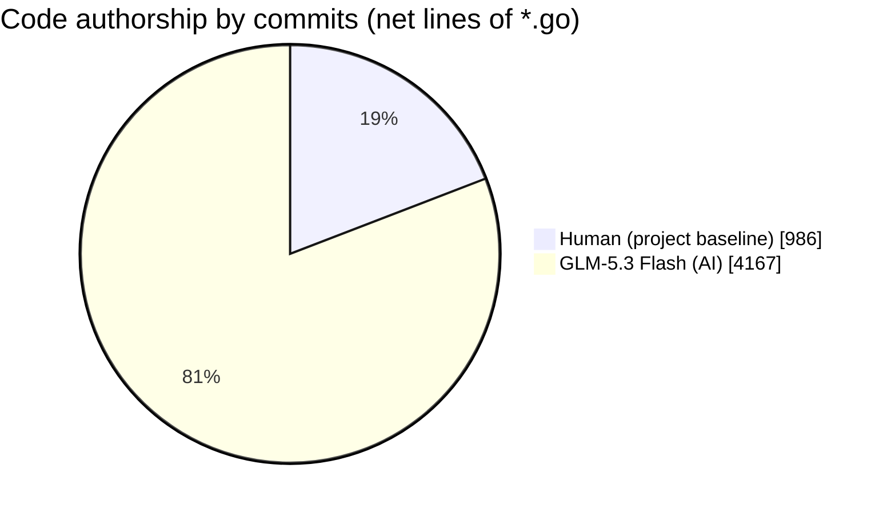

# simple-png

**English** | [简体中文](./README.zh-CN.md)

A pure Go PNG library working at the chunk level: parse, inspect, edit and
write back PNG datastreams while untouched chunks stay **byte for byte
identical** — plus a full image encoder with filter/compression control.

- decode pixels to standard `image.Image` types (`*image.Gray`,
  `*image.Gray16`, `*image.NRGBA`, `*image.NRGBA64`, `*image.RGBA`,
  `*image.RGBA64`, `*image.Paletted`), Adam7 interlaced and tRNS transparency
  supported, faster than the standard library on large images
- structured chunks: IHDR, PLTE, tEXt / zTXt / iTXt (e.g. XMP), tIME, pHYs,
  tRNS, bKGD, hIST, sBIT, cHRM, gAMA, **sRGB, iCCP, eXIf** (IFD entries view)
- every not-decoded chunk (e.g. sPLT) stays reachable in raw form, and any
  custom chunk type can be parsed with a few lines of code
- write back: chunks untouched during parsing are copied verbatim, modified
  chunks are re-serialized (zTXt/iCCP stay compressed-byte-identical unless
  their payload changed) and every CRC is recomputed
- encode standard library images with the five-filter adaptive heuristic,
  optional Adam7 interlace, any zlib level and free ancillary chunk injection
  (e.g. inject uncompressed XMP by hand)

[PNG (Portable Network Graphics) Specification](https://www.w3.org/TR/PNG-Chunks.html)

## Install

```
go get github.com/XC-Zero/simple-png
```

and import it:

```go

	import "github.com/XC-Zero/simple-png"

```

## Parse & decode

```go

	open, err := os.Open("./png-format.png")
	if err != nil {
		panic(err)
	}
	// CRC-32 verification of each chunk is optional and off by default,
	// pass true as a second argument to opt in
	p, err := ParsePng(open)
	if err != nil {
		panic(err)
	}
	// print png image data
	log.Println(*p.IDATs[0])
	// print png additional text
	log.Println(*p.TEXTs[0])

	// decode the image (idat -> unfiltered pixels -> standard image.Image)
	// Adam7 interlaced pngs are supported
	img, err := p.IDATsToColor()
	if err != nil {
		panic(err)
	}
	log.Println(img.Bounds(), img.ColorModel())

	// metadata: tEXt / zTXt / iTXt (e.g. XMP) / tIME / pHYs / tRNS / bKGD ...
	for _, x := range p.ITXTs {
		if x.Keyword == "XML:com.adobe.xmp" {
			log.Println("XMP:", x.Text)
		}
	}

	// struct-backed chunks: sRGB rendering intent, iCCP profile, eXIf IFDs
	if p.SRGB != nil {
		log.Println("sRGB rendering intent:", p.SRGB.RenderingIntent)
	}
	if p.ICCP != nil {
		log.Println("iCCP profile:", p.ICCP.Name, len(p.ICCP.Profile), "bytes")
	}
	if p.EXIF != nil {
		// flattened read-only view over IFD0 + Exif/GPS sub-IFDs
		entries, err := p.EXIF.Entries()
		if err != nil {
			panic(err)
		}
		for _, e := range entries {
			log.Printf("exif entry tag %#x type %d count %d", e.Tag, e.Type, e.Count)
		}
	}

	// chunks the library does not decode natively (e.g. sPLT) come back raw
	for _, rc := range p.RawChunks() {
		log.Println(rc.Name, len(rc.Data))
	}
```


### EDIT: modify metadata and write the png back

```go

	open, err := os.Open("./png-format.png")
	if err != nil {
		panic(err)
	}
	p, err := ParsePng(open)
	if err != nil {
		panic(err)
	}

	// editing is done through the parsed structs, e.g. append an XMP block
	// as an iTXt chunk (must be inserted before the first IDAT)
	name, payload, err := NewITXTChunk("XML:com.adobe.xmp", "", "", xmpString, true)
	if err != nil {
		panic(err)
	}
	if err = p.AddRawChunk(name, payload); err != nil {
		panic(err)
	}
	// drop a chunk we do not want anymore
	p.DeleteRawChunk("eXIf")
	// update the tIME
	p.TIME.Year = 2026

	// write back: untouched chunks are copied byte for byte, edited ones are
	// re-serialized, every chunk crc is recomputed
	var buf bytes.Buffer
	if _, err = p.WriteTo(&buf); err != nil {
		panic(err)
	}
	_ = buf.Bytes()
```


### ENCODE: create png streams from standard library images

```go

	// default settings: adaptive filter heuristic + zlib default level
	img := image.NewNRGBA(image.Rect(0, 0, w, h))
	var buf bytes.Buffer
	if _, err = simple_png.Encode(img, &buf); err != nil {
		panic(err)
	}

	// full control: zlib level (CompressionNone/1..9), filter strategy, IDAT
	// chunk size, Adam7 interlace, plus ancillary chunks written before the
	// first IDAT
	enc := &simple_png.Encoder{
		CompressionLevel: 9,
		FilterStrategy:   simple_png.FilterHeuristic,
		ChunkSize:        0,
		Interlace:        true, // Adam7 progressive rendering
	}
	name, payload, err := simple_png.NewITXTChunk("XML:com.adobe.xmp", "", "", xmp, true)
	if err != nil {
		panic(err)
	}
	if _, err = enc.Encode(img, &buf,
		simple_png.RawChunk{Name: simple_png.PHYSChunk, Data: phys},
		simple_png.RawChunk{Name: name, Data: payload},
	); err != nil {
		panic(err)
	}

	// or replace the pixels of an already parsed file (the color type and
	// bit depth must match, any size) while keeping ALL its metadata chunks
	// in their original positions; interlaced files are re-encoded interlaced
	if err = p.ReplaceImage(newImg); err != nil {
		panic(err)
	}
	var out bytes.Buffer
	if _, err = p.WriteTo(&out); err != nil {
		panic(err)
	}
```


### You also can custom chunk parse~

Every chunk the library does not decode natively (e.g. `sPLT`) stays in raw
form and any 4 byte chunk type can be hooked with your own struct:

```go

    // implement two methods to hook your own chunk type
    type CustomChunkParse struct {
        Data []byte
    }

    func (c *CustomChunkParse) ChunkName() ChunkName {
        return ChunkName("cust")
    }

    // Parse receives the raw chunk (name + data + crc) and fills the struct
    func (c *CustomChunkParse) Parse(chunk RawChunk) error {
        c.Data = chunk.Data
        return nil
    }

    p, err := ParsePng(open)     // ... error handling
    c := &CustomChunkParse{}
    err = p.ParseChunk(c)        // consumes the matching chunk
    // retrieval: ParseChunk stores the parser unless notSave was set
    found, err := p.GetOtherChunkByName("cust")

```

Notes:

- several occurrences of a chunk type consume several parsers, one
  `ParseChunk` call each
- while writing back, chunks parsed with a custom type are copied **byte for
  byte** (the library has no serializer for them) — to change the payload of
  a custom chunk, use `DeleteRawChunk` + `AddRawChunk` with new bytes
- the raw `RawChunks()` list is the simplest read path when no custom struct
  is worth the effort
- one rule from the concurrency section: the `Parse` callback must not call
  back into the same `Png` instance
```


---

# Png Struct


  


---
## Benchmark

compare with the standard library `image/png` (benchtime 2s, win/amd64, same machine):

| | simple_png | std lib |
|---|---|---|
| demo.png (256×81 rgb) **decode** | 277 µs | 205 µs |
| png-format.png (575×1083 rgba, 131 idat chunks) **decode** | **24.7 ms** | 25.2 ms |
| png-format.png **ParsePng only** (chunks + metadata, no pixels) | **0.66 ms** | not possible |
| 575×1083 rgba **encode** | 52.0 ms | 37.0 ms |

`IDATsToColor` decodes the standard image types (`*image.Gray`, `*image.Gray16`, `*image.RGBA`, `*image.RGBA64`, `*image.NRGBA`, `*image.NRGBA64`, `*image.Paletted`, matching the jpeg/png standard decoder conventions), so the result is a fully compliant `image.Image` and works with `draw` or any pipeline that accepts `image.Image`.


---
## Concurrency

Parsing with separate `Png` instances (one `ParsePng` per goroutine) is fully
concurrency safe. On a single instance, the readers (`RawChunks`, `RawChunkByName`,
`GetOtherChunkByName`, `IDATsToColor`, `WriteTo`) and the editing methods
(`ParseChunk`, `AddRawChunk`, `DeleteRawChunk`, `ReplaceImage`) are guarded by an
internal RWMutex, so mixed concurrent read/write use of one instance is also
safe. One rule to remember: the `Parse` callback of a custom chunk passed to
`ParseChunk` must not call back into the same `Png` instance (an RWMutex is not
reentrant). Everything is verified with `go test -race` stress tests.


---
## AI powered

This project is built with heavy help of AI coding agents:

**Powered by [GLM-5.3 Flash](https://z.ai)** — special thanks to
[OpenCode](https://opencode.ai) for the free token quota that made this round
of development possible.

Code authorship, measured by commit authorship net lines of `*.go`
files (project baseline vs AI increment):



**81%** of the current Go code was written by AI, but verified every bit as
hard: 51 tests plus `go vet` on Windows and a full `-race` run on Linux for
every iteration. The numbers above come straight from
`git diff --shortstat`, no eyeballing involved.


---
## TODO:
 - encoder performance tuning (reduce allocations of the filter heuristic)
 - CI workflow (linux race tests)


---
