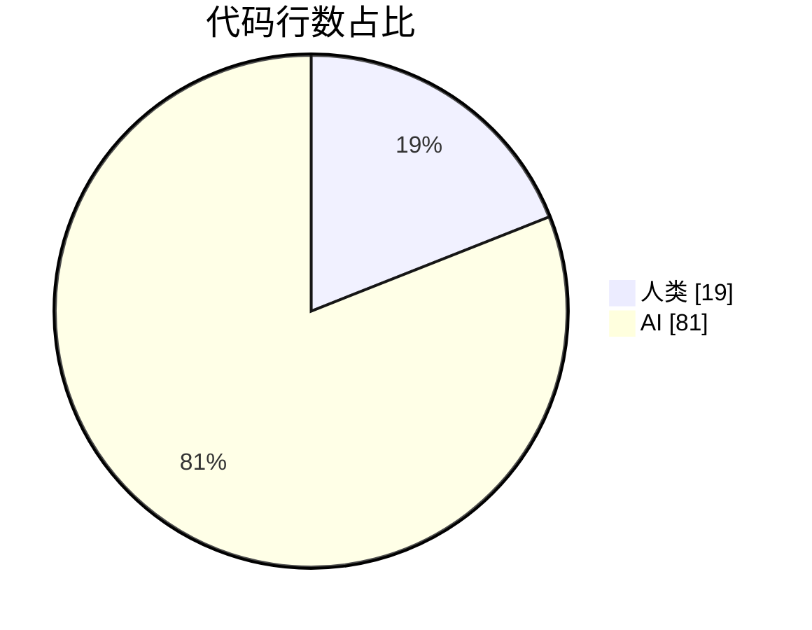

# simple-png

> [!NOTE]
> 🚀 **首次发版，灰度测试中。** 有任何问题或建议，欢迎提 [issue](https://github.com/knoweather/simple-png/issues)！

[English](./README.md) | **简体中文**

一个在 chunk 层面工作的纯 Go PNG 库：解析、检查、修改并回写 PNG 数据流，
未被触碰的部分回写时保持**逐字节一致**——同时提供带滤波/压缩控制的完整图像编码器。

- 把像素解码为标准 `image.Image` 类型（`*image.Gray`、`*image.Gray16`、
  `*image.NRGBA`、`*image.NRGBA64`、`*image.RGBA`、`*image.RGBA64`、
  `*image.Paletted`），支持 Adam7 交错与 tRNS 透明，大图解码快于标准库
- 结构化解析：IHDR、PLTE、tEXt / zTXt / iTXt（如 XMP）、tIME、pHYs、
  tRNS、bKGD、hIST、sBIT、cHRM、gAMA，以及 **sRGB、iCCP、eXIf**（IFD 条目视图）
- 库暂未结构化的 chunk（如 sPLT）以原始形式保留、随时可取，任何自定义
  chunk 类型都可以用几行代码接入解析
- 回写：解析过程中未被修改的 chunk 原样复制，修改过的 chunk 重新序列化
  （zTXt/iCCP 未改载荷时保持压缩后的逐字节一致），所有 CRC 重新计算
- 编码标准库图像：五滤波自适应启发式、可选 Adam7 交错、任意 zlib 等级、
  自由注入附加 chunk（如手工注入未压缩 XMP）

[PNG (Portable Network Graphics) 规范](https://www.w3.org/TR/PNG-Chunks.html)

## 安装

```
go get github.com/knoweather/simple-png
```

然后导入：

```go

	import "github.com/knoweather/simple-png"

```

## 解析与解码

```go

	open, err := os.Open("./png-format.png")
	if err != nil {
		panic(err)
	}
	// 每个 chunk 的 CRC-32 校验是可选的，默认关闭，第二个参数传 true 开启
	p, err := ParsePng(open)
	if err != nil {
		panic(err)
	}
	// 打印 png 图像数据
	log.Println(*p.IDATs[0])
	// 打印 png 附加文本
	log.Println(*p.TEXTs[0])

	// 解码图像（idat -> 反滤波像素 -> 标准 image.Image）
	// 支持 Adam7 交错的 png
	img, err := p.IDATsToColor()
	if err != nil {
		panic(err)
	}
	log.Println(img.Bounds(), img.ColorModel())

	// 元数据：tEXt / zTXt / iTXt（如 XMP）/ tIME / pHYs / tRNS / bKGD ...
	for _, x := range p.ITXTs {
		if x.Keyword == "XML:com.adobe.xmp" {
			log.Println("XMP:", x.Text)
		}
	}

	// 结构体支持的 chunk：sRGB 渲染意图、iCCP 配置文件、eXIf IFD
	if p.SRGB != nil {
		log.Println("sRGB rendering intent:", p.SRGB.RenderingIntent)
	}
	if p.ICCP != nil {
		log.Println("iCCP profile:", p.ICCP.Name, len(p.ICCP.Profile), "bytes")
	}
	if p.EXIF != nil {
		// IFD0 + Exif/GPS 子 IFD 的扁平只读视图
		entries, err := p.EXIF.Entries()
		if err != nil {
			panic(err)
		}
		for _, e := range entries {
			log.Printf("exif entry tag %#x type %d count %d", e.Tag, e.Type, e.Count)
		}
	}

	// 库暂未结构化的 chunk（如 sPLT）以原始形式返回
	for _, rc := range p.RawChunks() {
		log.Println(rc.Name, len(rc.Data))
	}
```


### EDIT：修改元数据并回写 png

```go

	open, err := os.Open("./png-format.png")
	if err != nil {
		panic(err)
	}
	p, err := ParsePng(open)
	if err != nil {
		panic(err)
	}

	// 编辑通过解析后的结构体完成，例如把 XMP 块以 iTXt 形式追加
	//（必须插在第一个 IDAT 之前）
	name, payload, err := NewITXTChunk("XML:com.adobe.xmp", "", "", xmpString, true)
	if err != nil {
		panic(err)
	}
	if err = p.AddRawChunk(name, payload); err != nil {
		panic(err)
	}
	// 删除不再需要的 chunk
	p.DeleteRawChunk("eXIf")
	// 更新 tIME
	p.TIME.Year = 2026

	// 回写：未触碰的 chunk 逐字节复制，修改过的重新序列化，
	// 所有 chunk 的 CRC 重新计算
	var buf bytes.Buffer
	if _, err = p.WriteTo(&buf); err != nil {
		panic(err)
	}
	_ = buf.Bytes()
```


### ENCODE：从标准库图像生成 png 流

```go

	// 默认设置：自适应滤波启发式 + zlib 默认压缩等级
	img := image.NewNRGBA(image.Rect(0, 0, w, h))
	var buf bytes.Buffer
	if _, err = simple_png.Encode(img, &buf); err != nil {
		panic(err)
	}

	// 完全可控：zlib 等级（CompressionNone/1..9）、滤波策略、IDAT 分块
	// 大小、Adam7 交错，以及写在第一个 IDAT 之前的附加 chunk
	enc := &simple_png.Encoder{
		CompressionLevel: 9,
		FilterStrategy:   simple_png.FilterHeuristic,
		ChunkSize:        0,
		Interlace:        true, // Adam7 渐进式渲染
	}
	name, payload, err := simple_png.NewITXTChunk("XML:com.adobe.xmp", "", "", xmp, true)
	if err != nil {
		panic(err)
	}
	if _, err = enc.Encode(img, &buf,
		simple_png.RawChunk{Name: simple_png.PHYSChunk, Data: phys},
		simple_png.RawChunk{Name: name, Data: payload},
	); err != nil {
		panic(err)
	}

	// 或者替换已解析文件的像素（颜色类型与位深必须一致，尺寸不限），
	// 同时按原位置保留其全部元数据 chunk；交错文件按交错重新编码
	if err = p.ReplaceImage(newImg); err != nil {
		panic(err)
	}
	var out bytes.Buffer
	if _, err = p.WriteTo(&out); err != nil {
		panic(err)
	}
```


### 也支持自定义 chunk 解析~

库暂未原生解码的 chunk（如 `sPLT`）会以原始形式保留，任何 4 字节 chunk
类型都能挂上你自己的结构体：

```go

    // 实现两个方法即可接入自定义 chunk 类型
    type CustomChunkParse struct {
        Data []byte
    }

    func (c *CustomChunkParse) ChunkName() ChunkName {
        return ChunkName("cust")
    }

    // Parse 收到原始 chunk（名字 + 数据 + CRC），把内容填进结构体
    func (c *CustomChunkParse) Parse(chunk RawChunk) error {
        c.Data = chunk.Data
        return nil
    }

    p, err := ParsePng(open)     // ... 错误处理省略
    c := &CustomChunkParse{}
    err = p.ParseChunk(c)        // 消费匹配的 chunk
    // 取回：除非调用时传了 notSave，ParseChunk 会把解析器存起来
    found, err := p.GetOtherChunkByName("cust")

```

说明：

- 同一类型出现多次时，每调用一次 `ParseChunk` 消费一个
- 回写时，用自定义类型解析过的 chunk 会**逐字节原样**输出（库没有它的
  序列化器）——要修改自定义 chunk 的载荷，用 `DeleteRawChunk` +
  `AddRawChunk` 换新字节
- 若自定义结构体不值当，直接读 `RawChunks()` 原始列表是最简单的路径
- 并发一节的规则同样适用：`Parse` 回调不要回调同一个 `Png` 实例


---

# Png Struct


  


---
## 基准测试

与标准库 `image/png` 对比（benchtime 2s，win/amd64，同一台机器）：

| | simple_png | 标准库 |
|---|---|---|
| demo.png（256×81 rgb）**解码** | 277 µs | 205 µs |
| png-format.png（575×1083 rgba，131 个 idat 块）**解码** | **24.7 ms** | 25.2 ms |
| png-format.png **仅 ParsePng**（chunk + 元数据，不解码像素） | **0.66 ms** | 标准库做不到 |
| 575×1083 rgba **编码** | 52.0 ms | 37.0 ms |

`IDATsToColor` 解码为标准图像类型（`*image.Gray`、`*image.Gray16`、`*image.RGBA`、`*image.RGBA64`、`*image.NRGBA`、`*image.NRGBA64`、`*image.Paletted`，与 jpeg/png 标准解码器约定一致），因此结果是完全合规的 `image.Image`，可用于 `draw` 或任何接受 `image.Image` 的管线。


---
## WebAssembly

读取 / 编辑 / 编码同样支持 `GOOS=js GOARCH=wasm`——无 cgo，整模块原样交叉编译。
`wasm` 包（`//go:build js && wasm` 标签）暴露小型 JS API；入口在 `cmd/pngwasm`：

```bash
GOOS=js GOARCH=wasm go build -o png.wasm ./cmd/pngwasm
```

JS 侧胶水来自 `$GOROOT/lib/wasm/wasm_exec.js`：

```js
globalThis.pngOpen(new Uint8Array(fileBytes))  // "" 或 "error: ..."
const sum = globalThis.pngSummary()            // 文件头 + 剩余块表 + 文本元数据视图
sum.itx // iTXt 条目（keyword/text/…——XMP 就在这里）
const px = globalThis.pngPixels()              // {dtype:"rgba8", width, height, bytes}
const enc = globalThis.pngEncode(4, 3, rgbaBytes, [{name:"iTXt", data}])
globalThis.pngSetRawChunk("cust", new Uint8Array([1, 2, 3]))
globalThis.pngDeleteRawChunk("gAMA")           // 只能删 raw/leftover 块
const out = globalThis.pngWrite()              // 重新序列化（未改动块逐字节原样）
globalThis.pngClose()
```

说明：

- `pngSummary()` 的块表只列**未被原生解析消费**的块（IHDR/IDAT/PLTE/文本块
  消费进结构体，改由 `idatCount` / `txx` / `itx` 视图上报）
- `pngDeleteRawChunk` 与 Go 侧 `DeleteRawChunk` 同语义：只能删 raw/leftover
  块；被消费的文本元数据在回写时原样保留
- Node 冒烟测试（`node wasm/smoke/smoke.mjs`）覆盖 打开 → 摘要 → 解码 →
  编码 → 编辑 → 回写 全链路

---
## 并发安全

多 goroutine 各自 `ParsePng` 解析（各自独立的 `Png` 实例）完全并发安全。同一个实例上，
读方法（`RawChunks`、`RawChunkByName`、`GetOtherChunkByName`、`IDATsToColor`、`WriteTo`）
与编辑方法（`ParseChunk`、`AddRawChunk`、`DeleteRawChunk`、`ReplaceImage`）
均由内部 RWMutex 保护，混合并发读写同一实例同样安全。
唯一要记住的规则：传给 `ParseChunk` 的自定义 chunk 的 `Parse` 回调不要回调
同一个 `Png` 实例的方法（RWMutex 不可重入）。全部通过 `go test -race` 压力测试验证。


---
## AI 加成

本项目在 AI 编程助手深度参与下完成：

**Powered by [GLM-5.3 Flash](https://z.ai)** — 特别感谢
[OpenCode](https://opencode.ai) 提供的免费额度，促成了这一轮开发。

代码占比，按提交口径统计 `*.go` 文件的净行数
（项目基线 986 行 vs AI 增量 4167 行）：



当前 Go 代码 **81%** 由 AI 编写，但验证同样硬核：每轮迭代都在 Windows 上跑
51 项测试 + `go vet`，并在 Linux 上完整跑 `-race`。以上数字直接来自
`git diff --shortstat`，不含任何目测水分。


---
## TODO:
 - 编码器性能调优（减少滤波启发式的内存分配）
 - CI workflow（linux race 测试）


---
